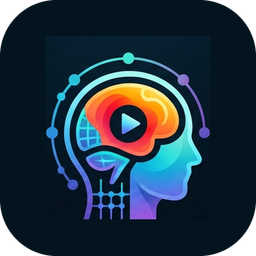

<p align="center"></p>

# NETScan

**NETScan** est une visionneuse locale pour études TEP/CT (18F-FDG) au format DICOM : SUV, points de fixation, mesures, comparaison de deux séances.

> Recherche / apprentissage uniquement, **pas un dispositif médical**. Les données restent sur votre machine.

## Téléchargement

Les applications prêtes à l'emploi sont dans la section [**Releases**](../../releases) :

- `PetScan-win64.zip` : Windows, sans installer Python (décompresser, lancer `PetScan.exe` ; SmartScreen peut avertir, exécutable non signé).
- `PetScan-android-debug.apk` : tablette Android 8.0+ (APK de debug, à autoriser en « sources inconnues »).

Ou depuis les sources :

```
pip install -e .
python viewer.py "<dossier DICOM>"   # http://127.0.0.1:8000
python viewer.py --demo              # volume synthétique, sans DICOM
python petscan.py <dossier> --thr 2.5 --mip mip.png   # ligne de commande
pytest -q
```

## Fonctions

### Chargement et SUV
- **Lecture DICOM rapide** : ouvre un dossier de séries TEP (et CT) en quelques secondes. Lecture parallèle adaptée au nombre de cœurs, barre de progression, en-têtes mis en cache.
- **SUV poids corporel** : valeurs quantitatives. Correction de la décroissance entre l'injection et l'acquisition.
- **Sélecteur de dossier au clic** : un clic dans le champ A ou B ouvre le sélecteur natif (Windows, Android). A et B sont indépendants ; « Charger » valide un chemin saisi.
- **Série CT au choix** : plusieurs CT dans l'examen ? Un menu permet de changer (les séries partielles sont signalées).
- **Infos patient** : lues dans les en-têtes, cadre replié par défaut, jamais enregistrées.

### Visualisation
- **Trois coupes** : axial, coronal, sagittal synchronisés, avec fenêtre SUV réglable et fusion TEP + CT.
- **Opacité du TEP** : curseur de 0 à 100 %. En mesure, réglé automatiquement (TEP ≥ 70 %, CT ≤ 20 %), modifiable ensuite.
- **MIP rotatif** : projection d'intensité maximale, curseur d'angle et lecture ; trois MIP alignés sur une ligne en comparaison.
- **Zoom et navigation** : molette = coupe, Ctrl + molette = zoom sous la souris, curseur de zoom, boutons −/+ à répétition, réinitialisation.
- **Autocentrage** : recentre l'image sur le point courant à chaque changement.
- **Thème** : clair, sombre ou identique au système (réglages).
- **Dates des séances** : JJ/mm, ou JJ/mm/aaaa si l'année diffère de l'année en cours.

### Points de fixation
- **Détection par seuil SUV** : SUVmax, SUVmean, MTV, TLG et pic par lésion. Seuil réglable par −/+ ou au clavier.
- **Filtre de volume** : masque les petites lésions sous un volume minimal (mL), avec compteur.
- **Tableau triable** : tri par n'importe quelle colonne, y compris la distance au dernier point cliqué.
- **Favoris** : étoile pour garder des points et y revenir.
- **Survol** : un anneau sur les trois vues repère la lésion survolée dans le tableau.
- **Localisation** : organe dans ou près duquel se trouve le point.

### Mesures
- **Règle** : distance en mm sur 2 clics, recalculée en direct.
- **Mesure auto** : région connexe autour du clic, sur le TEP (≥ X % du max local) ou le CT (± tolérance HU). Plus grand diamètre et étendue perpendiculaire.
- **Loupe ×4** : viseur creux pour placer les points précisément ; au tactile, appui long.

### Comparaison de deux séances
- **Recalage automatique** : B recalée sur A par translation (corrélation du squelette au CT), avec score.
- **Alignement fin** : curseurs z/y/x par séance, et bouton « Aligner B sur A (auto) » (zone locale ou corps entier).
- **Mix et différence** : A | B avec poignée de séparation, ou différence A − B (bleu = baisse, rouge = hausse).
- **Évolution par lésion** : SUVmax B et Δ % dans le tableau.

### Organes et export
- **Segmentation d'organes** (approximative) : poumons, cœur, foie, rate, reins, vessie, cerveau, squelette, par règles CT + TEP, hors ligne.
- **Export PDF** : coupes avec mesures, infos patient, liste des mesures. Le PDF contient l'identité du patient : à partager avec précaution.

### Tactile (tablette)
- **Appui long** : loupe ×4 qui suit le doigt.
- **Pincement** : zoom et déplacement à deux doigts.
- **Glisser-déposer natif désactivé** : pas de gêne au toucher.

### Confidentialité
- **Local uniquement** : serveur sur 127.0.0.1, contrôle de l'hôte, pas de journal des requêtes.

## Construire soi-même

`build/`, `dist/` et `*.spec` sont ignorés par git.

**Windows** (icône `assets/netscan.ico`) :

```
pip install -e . pyinstaller
python -m PyInstaller --noconfirm --clean --onedir --name PetScan --icon assets/netscan.ico --add-data "index.html;." viewer.py
```

Résultat : `dist/PetScan/` (à garder entier). Le build est propre à l'OS ; à refaire après toute modification.

**Android** : projet Gradle dans `android/` (serveur Python embarqué via [Chaquopy](https://chaquo.com/chaquopy/), Python 3.10, WebView, `arm64-v8a` et `x86_64`, minSdk 26). Prérequis : JDK 17 ou 21 (pas 25), SDK Android (platform 36), Python 3.10, et `android/local.properties` (non commité) :

```
sdk.dir=C:/Users/<vous>/AppData/Local/Android/Sdk
```

```
$env:JAVA_HOME = "C:\chemin\vers\jdk-21"
cd android
.\gradlew.bat assembleDebug
adb install -r app\build\outputs\apk\debug\app-debug.apk
```

À la première ouverture, l'appli demande l'accès à tous les fichiers (le serveur lit les DICOM par chemin). Copier l'examen dans un dossier de la galerie, puis toucher le champ de la séance.

## Limites

- **Android** : un examen réel demande beaucoup de RAM ; lecture DICOM séquentielle (plus lente) ; export PDF non testé dans la WebView ; APK de debug non signé ; carte SD non testée.
- **Mesure** : le seuil fixe capte aussi les fixations physiologiques (cerveau, cœur, vessie, reins) ; segmentation d'organes heuristique.
- **Comparaison** : translation seule (pas de rotation ni de déformation) ; SUV comparables seulement si dose, poids, incorporation et machine sont proches.
- **Absent** : SUL / SUV lean body mass, SUVpeak, DICOM multi-séries.
- Ne committez jamais de DICOM (`.gitignore` les exclut).
